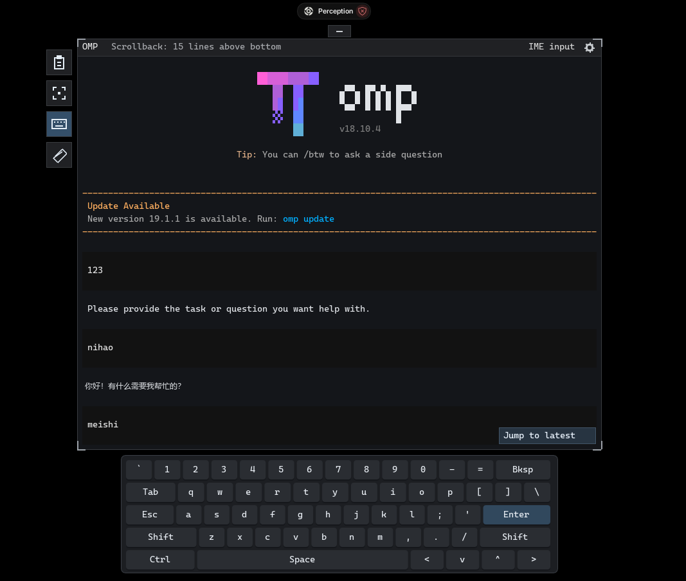

# OMP Terminal for Perception

Run the native Oh My Pi (OMP) terminal in a Perception overlay on Windows. An Enma script renders the terminal and handles interaction. A local host runs OMP through Windows ConPTY. OMP manages its own models, sign-in, and session history. [Oh My Pi](https://github.com/can1357/oh-my-pi)



## Requirements

- Windows x64.
- Perception with Enma scripting support.
- OMP installed at `%USERPROFILE%\.bun\bin\omp.exe`. Development testing used OMP v18.10.4.

## Install and run

1. Put these four files in the same folder. The host uses that folder as OMP's working directory.

   - `omp-terminal.em`
   - `omp-terminal-quiet.exe`
   - `omp-terminal-worker.exe`
   - `omp-capture-attachment.ts`

2. Open PowerShell in that folder and start the background host.

   ```powershell
   Start-Process -FilePath (Resolve-Path .\omp-terminal-quiet.exe).Path -ArgumentList '--background'
   ```

3. In Perception, open **Scripting** and load `omp-terminal.em`. The terminal opens as a window and restores its last saved position and size.

To start the host when you sign in to Windows, put a shortcut to `omp-terminal-quiet.exe --background` in your Windows Startup folder.

## Use the overlay

- Click inside the terminal to capture keyboard input. Press **Shift+F8** or click outside the terminal to release it. Use **Keyboard hook** in the gear menu to disable capture.
- Drag any corner to resize the window. Use the mouse wheel to scroll through terminal output. The gear menu also includes **Reset window layout**.
- Click the button above the window to minimize it to a floating ball. Drag the ball to move it, then click it to expand the terminal from that position.
- The side toolbar lets you paste text, capture a screen region, open an on-screen keyboard, or select a local file. Use **IME input** in the title bar to compose text with a Windows input method and insert it into the terminal.
- Images and screenshots appear as previews in the OMP draft. Other files appear as `@"file path"` references that OMP handles by file type. Review the draft and press **Enter** to send it.

## Troubleshooting

| Message | What to check |
| --- | --- |
| **OMP host unreachable** | Start the background host. It listens on the local loopback address `127.0.0.1:17844` and supports one running instance. |
| **omp.exe missing from .bun/bin** | Check that OMP is installed at `%USERPROFILE%\.bun\bin\omp.exe`. |
| **OMP host worker is missing** | Put both host executables in the same folder. |
| **OMP did not confirm the attachment** | Check that `omp-capture-attachment.ts` is next to the host executables. Restart the host and reload the script. |

## Update or uninstall

To update, unload the script in Perception, exit the background host, and replace the four files. Then start the host and load the script again. To uninstall, remove the files and any Startup shortcut you created. The saved window layout is in `omp-overlay-layout.json` in the same folder.

## Build from source

Open a Visual Studio 2022 x64 Developer Command Prompt and run:

```cmd
build.cmd "C:\path\to\libvterm" "C:\path\to\json-header-directory"
```

The first argument points to the libvterm checkout. The second points to the folder containing `json.hpp`. The build generates both host executables next to `build.cmd`. [libvterm commit 934bc2f](https://github.com/neovim/libvterm/tree/934bc2fbf21800ac3458a499df8820ca5fb45fd3) · [nlohmann/json 3.11.3 single header](https://github.com/nlohmann/json/blob/v3.11.3/single_include/nlohmann/json.hpp)

## License

OMP Terminal for Perception is licensed under the [MIT License](LICENSE). Third-party notices are included. [libvterm](LICENSE-libvterm.txt) · [nlohmann/json](LICENSE-json.txt) · [simple-keyboard](LICENSE-simple-keyboard.txt)
